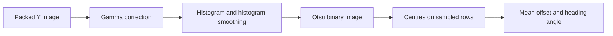

# ComputerVision

ComputerVision is a C# image-processing library for a line-following robot. It detects line-centre samples and provides position and direction observations. The repository includes a console runner, automated tests and recorded grayscale images. The intended robot platform is a Raspberry Pi Zero 2 W.

**Slovenský návod:** [vytvorenie vlastného repozitára zo šablóny, inštalácia a používanie](docs/sk/NAVOD.md). No robot, simulator or camera is needed to build the library or process the supplied images.

## Start here

1. Install the **.NET 10 SDK**, Git and a C# editor. The SDK is required; installing only the runtime is insufficient. See Microsoft's [installation guide](https://learn.microsoft.com/en-us/dotnet/core/install/).
2. Obtain access to this private repository. For an individual student copy, follow [the repository workflow](docs/WORKFLOW.md).
3. Clone your repository, open a terminal in its root, and run the commands below. All paths in this guide are relative to that root.

```sh
dotnet --version
dotnet restore ComputerVision.Student.slnx
dotnet build ComputerVision.Student.slnx -c Release --no-restore
dotnet test tests/ComputerVision.Tests/ComputerVision.Tests.csproj -c Release --no-build
dotnet run --project ComputerVision.Runner -c Release --no-build -- evaluate data/course results/evaluation.json
dotnet run --project ComputerVision.Runner -c Release --no-build -- benchmark data/course results/baseline.json 10 default
```

The test suite contains **65 test cases**, counting each parameterized case separately. Evaluation verifies the prepared image hashes and processes **503 images**. Benchmarking with 10 cycles measures **5,030 frames** after a warm-up. Generated reports go to `results/`, which Git ignores.

These projects target `net10.0`. `global.json` accepts installed stable .NET 10 feature bands starting at 10.0.100. The solution contains no Windows Forms or camera application; normal development commands are the same on Windows, Linux and macOS. This does not establish performance on the robot: that must be measured on its actual OS, runtime and hardware.

## What is in the repository?

| Path | Purpose |
| --- | --- |
| `ComputerVision/` | Production library: image model, pipeline stages, detection and geometry |
| `ComputerVision.Runner/` | Dataset verification, evaluation, import and timing commands |
| `tests/ComputerVision.Tests/` | xUnit tests of contracts and known regressions |
| `data/course/` | 503 prepared 128 × 96 grayscale frames and their manifest |
| `docs/PIPELINE.md` | Step-by-step algorithm, settings and result semantics |
| `docs/CODE_STYLE.md` | Documentation, formatting, numerical types and the shared curve evaluator |
| `docs/TESTING.md` | How to run tests, understand their coverage and diagnose failures |
| `docs/DATASET.md` | Raw image format, manifest and reference annotations |
| `docs/PERFORMANCE.md` | Repeatable timing, allocations and stage profiling |
| `docs/WORKFLOW.md` | Individual repository, branch, commits and pull request |
| `docs/sk/NAVOD.md` | Slovak instructions for creating and using your copy |
| `.github/workflows/ci.yml` | Build, tests and dataset processing on GitHub |

Recommended reading order: run the quick start, read the pipeline guide, inspect one synthetic test, then inspect the evaluation of a real image. Read the performance guide before claiming a speed improvement.

## What the algorithm does

The default pipeline receives a packed grayscale image, changes its brightness using gamma correction, builds and smooths an intensity histogram, chooses an Otsu threshold, finds a pair of edges on selected image rows, and converts their centres into an offset and an angle.



Resize, image smoothing, homography and curve fitting are optional stages. The [pipeline guide](docs/PIPELINE.md) explains their ordering and defaults.

Three facts are essential when using the API:

- **Processing can overwrite the input pixels.** Keep a pristine copy when repeating an experiment or when another detector needs the original grayscale image.
- **A missing line is represented by nullable results.** `Offset == null` is different from `Offset.X == 0`, which can mean a centred line. The host application decides how the robot reacts.
- **The detector takes the first edge pair it finds on a sampled row.** It does not reliably distinguish a line from an unrelated dark marking and does not classify markers.

## Minimal use from C#

Add a project reference to `ComputerVision/ComputerVision.csproj` in a console application, then use the following code from the repository root. The existing runner already provides a complete application if you prefer to start there.

```csharp
using ComputerVision.Models;
using ComputerVision.Pipeline;
using ComputerVision.Utils;

const int width = 128, height = 96;
byte[] original = File.ReadAllBytes("data/course/frame0000.y");
var settings = new LineDetectionSettings();
var outputSize = settings.GetOutputSize(width, height);
var pipeline = LineDetectionPipelineFactory.Create(settings);
var coordinates = new CoordTrans(
    0, outputSize.Width, outputSize.Height, 0,
    settings.FOWXmin, settings.FOWXmax, settings.FOWYmin, settings.FOWYmax);

// The clone keeps 'original' available for another run or detector.
var image = new YUVImage((byte[])original.Clone(), width, height);
var result = pipeline.Process(image, coordinates);

if (result.Offset is { } offset && result.HeadingAngle is { } angle)
{
    Console.WriteLine($"Lateral={offset.X:F3}, forward={offset.Y:F3}, angle={angle:F2} degrees");
}
else
{
    Console.WriteLine("No valid line observation");
}
```

The `CoordTrans` mapping above is the library's legacy linear observation mapping. Its ranges are not a camera calibration. For measured ground coordinates, use the separate calibrated outputs described in [the pipeline guide](docs/PIPELINE.md#coordinates-and-calibration).

## Inspect a result

Run the tests and save an evaluation report. Open `PipelineTests.BlackLineSurvivesOtsuAndHasCorrectCenter` and follow its synthetic image through the processing stages. In the JSON evaluation report, inspect `Points`, `Threshold`, `Offset` and `HeadingAngle`. A missing observation is a valid result; it must remain distinguishable from a centred line.
